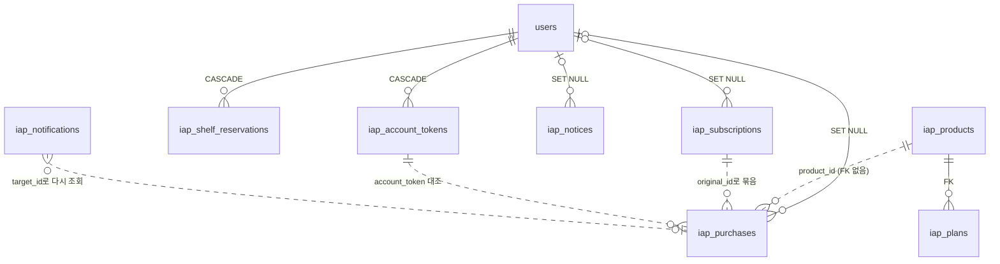

# 서버 DB 구조 (ERD)

- 서버 PostgreSQL의 표와 관계, 표와 칸마다 그렇게 둔 이유
- 지금은 **결제 표 8개**만 적었다. 다른 표(책, 책장, 커뮤니티, 로그인 등 V1~V20)는 아직 적지 않았다
- 결제 표는 아직 PR에 있다(운영 DB에는 없음). 마이그레이션이 바뀌면 이 문서도 같이 고친다
  - V21 (#21): `iap_account_tokens`, `iap_shelf_reservations`, `iap_products`, `iap_purchases`, `iap_subscriptions`, `iap_notifications`
  - V22 (#47): `iap_notices`
  - V23 (#48): `iap_plans`
- 처음 보는 결제 용어: [`guides/iap-glossary.md`](../guides/iap-glossary.md)
- 결정의 근거: [ADR-0002](../adr/0002-iap-design.md)(D번호), [ADR-0003](../adr/0003-iap-compliance.md)(L번호). 원문 SQL: `server/internal/server/migrations/V21__iap.sql` 등

## 1. 한눈에 보기

- 실선은 DB가 강제하는 외래 키, 점선은 코드가 값으로 잇는 관계

| 표 | 비유 | 한 줄의 단위 | 탈퇴하면 |
|---|---|---|---|
| `iap_products` | 메뉴판 | 파는 상품 1개 | 상관없음 |
| `iap_plans` | 메뉴판의 월·연 표시 | 구독 요금제 1개 | 상관없음 |
| `iap_purchases` | 영수증 장부 | 스토어가 확인해 준 거래 1건 | 남음(주인만 지움) |
| `iap_subscriptions` | 정기권 현황판 | 구독 한 줄기 | 남음(주인만 지움) |
| `iap_notifications` | 받은 우편함 | 스토어가 보낸 알림 1건 | 유저 칸이 없음 |
| `iap_notices` | 보낸 안내문 대장 | 유저에게 알린 결제 고지 1건 | 남음(주인만 지움) |
| `iap_account_tokens` | 회원 대조표 | 스토어에 넘긴 계정 연결 값 1개 | 같이 지움 |
| `iap_shelf_reservations` | 예약석 | 결제 중인 선반 예약 1건 | 같이 지움 |

## 2. 모든 표에 걸친 규칙

| 규칙 | 이유 |
|---|---|
| 권한(구독 여부, 선반 칸 수)을 저장하지 않고 매번 계산 (D5) | 권한 칸을 따로 두면 영수증과 어긋날 수 있다. 환불·갱신·이전 때마다 두 곳을 맞춰야 한다. 규모가 작아 계산 비용은 문제가 안 된다 |
| 결제 경로 `route`는 글자 값(`'apple'`, `'google'`), CHECK 없음 (D19) | 원스토어·웹 결제 같은 새 경로가 생겨도 표를 고치지 않게. 값 검사는 코드가 한다 |
| 시각은 전부 `TIMESTAMPTZ`(UTC) (D23) | 만료 판단을 서버 시계 하나로. 기기 시간대·시계 조작과 무관 |
| 금액은 `price_milli` 정수(통화 1단위 = 1000) (D20) | 실수형은 반올림 오차가 난다. 애플이 주는 단위와 같다 |
| 가격은 어느 표에도 없다 (D22) | 가격은 스토어가 정하고 나라마다 다르다. 화면은 스토어가 준 값을 그대로 보인다. 공개 저장소에 가격을 남기지 않는 규칙과도 맞다 |
| 결제 기록은 탈퇴해도 남기고 `user_id`만 비운다(`ON DELETE SET NULL`) (ADR-0003) | 전자상거래법이 계약·결제 기록 5년, 분쟁 기록 3년 보관을 정한다. 사람과의 연결을 끊어 익명으로 남긴다 |
| 원장이 아닌 표는 탈퇴하면 같이 지운다(`ON DELETE CASCADE`) | 회원이 없으면 쓸모가 없고, 남기면 지울 이유가 없는 개인정보만 늘어난다 |
| 중복을 DB의 유일 제약으로 막는다 (D6) | 앱 재전송, 애플 알림 재전송, 구글 Pub/Sub "최소 한 번 전달" 때문에 같은 것이 여러 번 온다. 코드의 "있나 보고 넣기"는 동시에 두 요청이 오면 둘 다 넣는다 |
| `env`(`production`/`sandbox`) 칸 (D15) | 심사·TestFlight의 시험 결제도 받되, 매출과 운영 권한에서 뺀다. 스위치를 끄면 시험 결제로 준 권한도 사라진다 |

## 3. 표마다

### 3.1 `iap_products` — 파는 상품

- 왜 표로 두나: "이 상품 ID가 무엇을 주는가"를 코드에 박으면 상품을 바꿀 때마다 서버를 다시 배포해야 한다. 운영자가 줄만 넣으면 되게 (D21)
- 키: `PRIMARY KEY (route, product_id)`. 애플과 구글은 같은 상품도 ID를 따로 등록한다

| 칸 | 이유 |
|---|---|
| `kind` (`subscription`/`product`) | 구독과 한 번 사는 상품은 확인 방법·권한 계산이 다르다 |
| `entitlement` | 구독이 주는 권한 이름(`plus`). 권한이 하나뿐이지만 이름으로 두면 나중에 등급을 늘리기 쉽다 (D2) |
| `shelves` | 선반 상품이 주는 칸 수(1, 3) |
| `consume` | 구글에서 소비 처리할지. 소비해야 같은 상품을 다시 살 수 있다. 연도마다 다시 사는 선반이라 기본 true (D1) |
| `active` | 그만 팔게 된 상품. 줄을 지우면 옛 영수증이 무엇을 줬는지 모르게 되므로 끄기만 한다 |
| CHECK(구독이면 권한만, 상품이면 칸 수만) | 구독인데 칸 수가 있거나 둘 다 빈 줄을 DB가 거절한다 |

### 3.2 `iap_plans` — 구독 요금제의 주기 (V23)

- 왜 있나: 연 구독은 갱신 14일 전에 알려야 한다(ADR-0003 L9). 그런데 애플·구글 응답 어디에도 "월인지 연인지"가 없다
- 키: `(route, product_id, plan_id)`. 애플은 상품 ID가 곧 요금제라 `plan_id`가 빈 값, 구글은 한 구독 상품에 월·연 요금제(base plan)가 함께 있다
- `iap_products`를 외래 키로 가리킨다: 없는 상품의 요금제를 넣지 못하게
- 줄이 없으면 주기를 모르는 것으로 보고 갱신 예정 고지를 보내지 않는다. 틀린 고지보다 안 보내는 쪽이 안전하다

### 3.3 `iap_purchases` — 거래 원장

- 한 줄 = 스토어가 확인해 준 거래 1건. **줄을 지우지 않는다**. 환불은 `state='revoked'`, `revoked_at`으로 남긴다
- 왜 지우지 않나: 법정 보관 기록이고, 환불 분쟁에서 "언제 무엇을 줬다가 언제 거뒀는지"가 필요하다

| 칸 | 이유 |
|---|---|
| `transaction_id` | 거래 1건의 ID. 애플은 거래 ID, 구글 한 번 사는 상품은 구매 토큰, 구글 구독은 주문 ID. 스토어마다 "한 건"을 가리키는 값이 달라서 |
| `original_id` | 구독 갱신 거래들을 한 줄기로 묶는 값. 갱신마다 거래 ID는 새로 생긴다 |
| `user_id` (SET NULL) | 탈퇴해도 거래는 남긴다(2장) |
| `account_token` | 스토어가 돌려준 계정 연결 값. 누구의 결제인지 대조할 증거로 남긴다. 앱 밖에서 산 구매 등은 비어 있다 |
| `shelf_year` | 선반이 열린 연도 책장. 넣을 때 계정 연결 값에서 찾아 **복사**한다. 연결 값 줄이 탈퇴로 지워져도 거래에는 연도가 남게 |
| `over_cap` | 두 기기에서 함께 사서 그 해 유료 3칸을 넘은 거래. 칸을 주지 않고 환불한다. 한 번 true면 false로 돌아가지 않는다(이미 환불을 요청했을 수 있어서) (D1) |
| `refund_requested_at`, `refund_attempts` | 넘은 거래의 구글 자동 환불 요청 시각과 시도 횟수. 실패하면 정기 작업이 다시 시도하고 20번이면 멈춘다. 애플은 개발자가 환불할 수 없어 비어 있다 |
| `state` (`paid`/`revoked`) | 환불을 줄 삭제 대신 상태로 |
| `confirmed_at` | 스토어에 확인(acknowledge·consume)을 마친 시각. 구글은 3일 안에 안 하면 자동 환불한다. 비어 있는 줄을 정기 작업이 다시 시도한다 |
| `currency`, `price_milli`, `country` | 스토어가 알려 준 결제 금액·통화·나라. 해외 판매와 매출 대조용 (D20). 구글 구매 조회는 금액을 주지 않아 비어 있다 |

| 제약·색인 | 이유 |
|---|---|
| `UNIQUE (route, transaction_id)` | 같은 거래를 두 번 내도 한 줄만. 칸을 두 번 주지 않는다. `route`를 함께 묶는 이유는 애플 ID와 구글 ID가 서로 다른 체계라 우연히 같은 글자가 나올 수 있어서 |
| `(user_id, kind)` 색인 | 권한 계산: "이 유저의 선반 거래" |
| `(route, original_id)` 색인 | 구독 줄기의 거래 모으기 |
| 조건부 색인 `WHERE over_cap AND refund_requested_at IS NULL AND state='paid'` | 환불을 다시 요청할 거래만 빨리 찾게. 해당 줄이 거의 없어 색인이 작다 |
| 조건부 색인 `WHERE confirmed_at IS NULL AND state='paid'` | 확인을 못 마친 거래만 빨리 찾게 |

### 3.4 `iap_subscriptions` — 구독 한 줄기의 지금 상태

- 한 줄 = 구독 하나. 갱신될 때마다 거래 줄은 늘고 이 줄은 고쳐진다
- 왜 거래와 따로 두나: 거래 줄만으로 "지금 구독 중인가"를 알려면 매번 마지막 거래를 찾고 유예·해지 예약까지 계산해야 한다. 스토어가 주는 "지금 상태"를 한 줄로 받아 둔다

| 칸 | 이유 |
|---|---|
| `original_id` | 구독 줄기의 ID(애플 원 거래 ID, 구글 구매 토큰) |
| `user_id` (SET NULL) | "구매 복원"을 누른 계정으로 바뀔 수 있다. 한 번에 한 계정만 가진다 (D8). 탈퇴해도 줄은 남는다 |
| `plan_id` | 구글 요금제(월·연). 애플은 빈 값 |
| `state` (`paid`/`inactive`/`revoked`) | 유효 / 만료·보류 / 환불 |
| `expires_at` | 만료 시각. 서버 시계로 비교한다 (D23) |
| `grace_until` | 결제 실패 유예가 끝나는 시각. 유예 중에는 권한을 유지한다 (D11) |
| `auto_renew` | false면 해지 예약. 만료일까지는 유효하다 (D12) |
| `latest_transaction_id` | 마지막 갱신 거래. 스토어에 다시 물을 때 쓴다 |

- `UNIQUE (route, original_id)`: 같은 구독이 두 줄로 생기면 권한 계산이 틀어진다. 앱 제출과 스토어 알림이 동시에 와도 한 줄

### 3.5 `iap_notifications` — 스토어가 보낸 알림

- 한 줄 = 애플·구글이 보낸 알림 1건. **원문(`payload`)을 그대로 남긴다**: 분쟁과 버그 추적, 처리 코드를 고친 뒤 다시 처리하기
- 유저 칸이 없다: 알림은 스토어가 보낸 것이라 받을 때는 주인을 모를 수 있다. 처리하면서 거래·구독 표로 주인을 찾는다

| 칸 | 이유 |
|---|---|
| `notification_id` | 애플 `notificationUUID`, 구글 Pub/Sub `messageId`. 재전송된 알림은 같은 값이다 |
| `kind` | 스토어가 준 종류 값 그대로. 우리 이름으로 바꾸지 않아 원문과 대조하기 쉽다 |
| `target_kind`, `target_id`, `original_id`, `order_id` | 받을 때 꺼내 둔 "다시 물어볼 대상". 처리할 때 원문을 다시 풀지 않게. **상태는 적지 않는다**: 알림은 늦게·순서가 바뀌어 오므로, 처리할 때 스토어에 지금 상태를 다시 묻는다 |
| `result` (`received`/`processed`/`ignored`/`failed`), `attempts`, `error` | 받자마자 200을 돌려주고 나중에 처리한다(#44). 실패하면 정기 작업이 다시 시도한다 |

- `UNIQUE (route, notification_id)`: 같은 알림을 두 번 처리하지 않는다. 구글 문서가 직접 `messageId` 중복 확인을 요구한다
- 조건부 색인 `WHERE result IN ('received','failed')`: 처리할 알림만 빨리 찾게

### 3.6 `iap_notices` — 유저에게 보낸 결제 고지 (V22)

- 한 줄 = 앱 알림함에 넣은 결제 고지 1건(결제 완료, 결제 실패, 만료, 해지 접수, 환불, 넘은 선반 결제)
- 왜 있나: 결제 실패·만료·환불은 법적으로 알려야 하고, 알렸다는 증빙이 필요하다(ADR-0003 L8·L11). 알림함이 기준이고 푸시는 보조다

| 칸 | 이유 |
|---|---|
| `user_id` (SET NULL) | 탈퇴해도 "알렸다"는 기록은 남긴다. 거래 표와 같다 |
| `template`, `template_version`, `params` | **문구를 저장하지 않고** 문구 번호와 버전, 채울 값만. 문구는 `docs/legal/notice-templates.md`. 문구를 고쳐도 옛 고지가 어떤 판이었는지 안다 |
| `params`에 금액 없음 | 가격은 스토어가 정한다 (D22) |
| `dedupe_key` | 같은 일을 두 번 알리지 않게. 같은 스토어 알림을 다시 처리해도 고지는 한 줄 |
| `read_at` | 읽은 시각. 안 읽은 수와 "확인했다" 증빙 |
| `env` | 시험 결제의 고지는 샌드박스 스위치가 꺼지면 숨긴다 |

- `UNIQUE (user_id, dedupe_key)`: 위 중복 방지. PostgreSQL은 유일 키에서 NULL끼리 서로 다른 값으로 보므로, 탈퇴로 주인이 빈 줄끼리는 부딪히지 않는다
- 상태를 바꾸는 같은 트랜잭션에서 쓴다: 구독은 만료됐는데 고지만 빠지는 일이 없게

### 3.7 `iap_account_tokens` — 계정 연결 값 (회원 대조표)

- 무엇: 결제할 때 앱이 스토어에 넘기는 무작위 UUID. 스토어는 이후 영수증과 알림마다 이 값을 돌려준다. 서버는 이 표로 "누구의 결제인지" 찾는다 (D7)
  - 애플 `appAccountToken`, 구글 `obfuscatedAccountId`
- 왜 필요한가: 갱신·환불 알림은 앱이 꺼져 있을 때 스토어가 서버로 바로 보낸다. 이 값이 없으면 서버는 그 결제가 누구 것인지 모른다
- 왜 유저 번호를 그대로 넘기지 않나
  - 애플은 UUID 형식만 보장한다
  - 구글은 이 칸에 개인정보를 넣으면 결제를 막는다. 무작위 UUID라 해당 없다
  - 내부 번호를 밖에 내보내지 않는다
- 왜 유저 표의 칸이 아니라 따로 표인가: 유저 하나가 값을 여러 개 가진다
  - 애플은 첫 구매 때 값이 굳는다. 구독을 다른 계정으로 옮겨도(D8) 옛 값이 계속 온다
  - 선반은 연도마다 값이 따로다(아래)

| 칸 | 이유 |
|---|---|
| `token` (PK, UUID) | 스토어에 넘기는 값 |
| `user_id` (CASCADE) | 탈퇴하면 같이 지운다. 거래에는 `account_token`과 `shelf_year`가 이미 복사돼 있어 대조표가 없어도 기록은 온전하다 |
| `year` | 선반용 값이 여는 연도 책장. 구독용은 NULL |

- **연도마다 값을 따로 두는 이유** (D1)
  - 스토어 영수증에는 "몇 년 책장용"이라는 정보가 없다. 상품은 그냥 "선반 1칸"이다
  - 그래서 값에 연도를 숨긴다. 2026년 칸을 살 때는 2026년 값을, 2027년 칸을 살 때는 2027년 값을 넘긴다. 돌아온 값만 보고 연도를 안다
  - 앱이 결제 도중 꺼져 결제가 스토어 알림으로만 와도 연도를 잃지 않는다
- 조건부 유일 색인 `(user_id, year) WHERE year IS NOT NULL`
  - 한 유저의 한 연도에는 값이 하나뿐이다
  - 막는 일: 태블릿과 폰이 동시에 "2026년 값 주세요"라고 하면 각자 새 값을 만들어 두 장이 될 수 있다. 색인이 있으면 늦은 쪽은 먼저 만든 값을 받는다
  - `WHERE year IS NOT NULL`은 구독용 값(연도 없음)을 이 규칙에서 빼는 조건이다
- 현업과 다른 점
  - 애플은 WWDC 2025에서 "한 회원의 모든 구매에 같은 값을 쓰라"고 권한다. 우리는 연도마다 따로 쓴다
  - 권장일 뿐 규칙 위반은 아니다. 흔한 대안은 "값은 하나, 결제 전에 서버에 주문서 줄을 만들어 대조"인데, 서로 다른 해의 결제 두 건이 동시에 걸리면 어느 쪽인지 헷갈린다
  - 감수하는 위험: Apple ID 이메일을 옮기면 값이 따라오지 않았다는 사례가 있다. 값이 하나여도 똑같고, 그때는 "구매 복원"으로 다시 잇는다
  - 확인할 위험 (2026-11-20 조사): 애플 포럼에 "구매할 때 새 값을 넘겼는데 처음 쓴 값이 돌아왔다"는 보고가 있다(스레드 800411, 819561, 787143). 셋 다 샌드박스이고, 애플은 버그 신고만 요청했으며 인정·수정은 없다. 운영 소모성 상품 사례는 1건(759222)이고 앱이 넘긴 값이 기록되지 않아 확인되지 않는다
    - 막지 않으면: 2027년 칸을 샀는데 2026년 값이 돌아와 2026년 책장에 들어간다. 2026년이 이미 3칸이면 넘은 거래로 환불된다. 칸을 더 주는 쪽으로는 틀리지 않지만 손해는 사용자가 본다
    - 처리함 (2026-11-20, PR #43 `353b51d`): 연도는 이 순서로 정한다. ① 앱이 낸 결제 중 예약(3.8)의 연도 ② 거래에 돌아온 계정 연결 값의 연도 ③ 앱이 보낸 `year`
      - 예약은 서버가 이 회원에게 준 것만 쓴다(남의 예약 번호는 무시). 5분이 지났어도 지워지기 전이면 쓴다
      - 새로 넣은 거래만 바꾼다. 알림으로 먼저 들어와 이미 칸을 센 거래는 그대로 둔다
      - 3칸 상한은 바뀐 연도로 다시 센다. 그래서 칸을 더 받아 갈 구멍은 없다. 표는 그대로다
    - 남은 틈: 알림이 앱 제출보다 먼저 오면 계정 연결 값의 연도로 들어간다. 그때 값이 틀렸으면 위 순서가 적용되지 않는다
    - 확인: 샌드박스에서 연도가 다른 선반을 연달아 산다(출시 점검표 4장). 서버 로그에 `iap shelf year from reservation`이 나오면 애플이 앞 값을 돌려준 것이다

### 3.8 `iap_shelf_reservations` — 선반 결제 중 예약

- 한 줄 = 한 기기가 선반 결제창을 띄운 동안 잡아 둔 칸(5분)
- 왜 있나: 태블릿과 폰에서 같은 해 선반을 동시에 사면 유료 3칸을 넘을 수 있다. 결제창을 띄우기 전에 막는다 (D1, 2026-11-19)
- 원장이 아니다: 지워도 되는 임시 줄. 결제가 끝나거나 취소되면 지우고, 앱이 꺼져 남은 줄은 `expires_at`이 지나면 무시한다

| 칸 | 이유 |
|---|---|
| `user_id` (CASCADE) | 탈퇴하면 같이 지운다 |
| `year`, `shelves` | 어느 해 책장에 몇 칸을 잡았나 |
| `expires_at` | 5분 뒤. 앱이 꺼져도 영원히 막히지 않게 |

- 판정: "산 칸 + 살아 있는 예약 + 이번 칸 > 3"이면 409 `iap_shelf_busy`. 유저 줄을 잠그고(`SELECT ... FOR UPDATE`) 세어 동시에 두 요청이 와도 하나만 통과한다
- 그래도 넘는 경우(예약이 끝난 뒤 늦게 결제 등)는 `iap_purchases.over_cap`이 두 번째 방어선이다

## 4. 아직 없는 것

- 보관 기간(5년·3년)이 지난 결제 기록을 지우는 작업. 출시 전에 만든다(출시 점검표 3장)
- 결제 표 밖의 표(V1~V20) 설명
